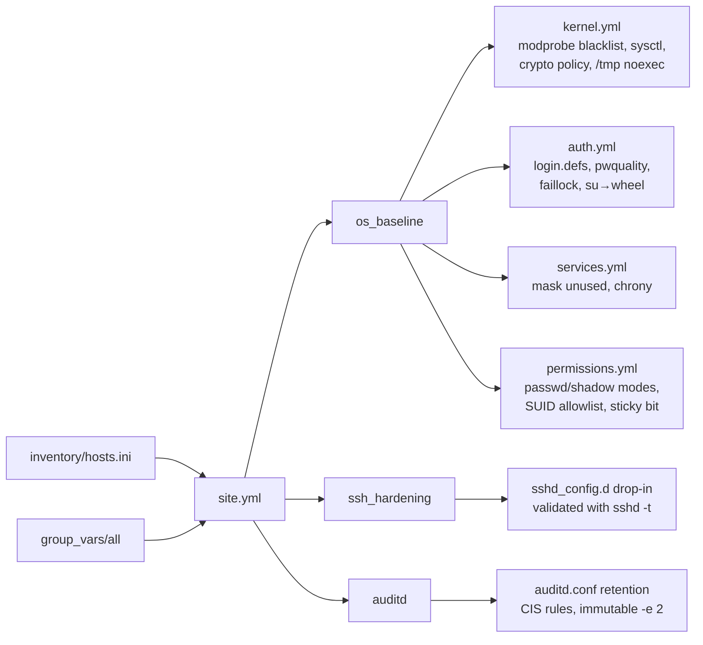

# ansible-rhel-hardening

[](https://github.com/vince-sre/ansible-rhel-hardening/actions/workflows/ci.yml)


Ansible roles that apply a CIS-aligned security baseline to RHEL 8/9 servers: kernel and sysctl hardening, password and lockout policy, an SSH server lockdown, auditd rules, service minimization and a SUID/SGID and sticky-bit audit.

It's a personal, modernized take on the hardening I've done for years on RHEL fleets, from implementing the CIS RHEL benchmark as a Linux administrator to post-provisioning configuration on cloud VMs built with Terraform and Packer. It's not any employer's code.

## Architecture



## Roles

| Role | What it enforces | Key variables |
|---|---|---|
| `os_baseline` | Blocks unused filesystems and protocols (cramfs, udf, usb-storage, dccp, sctp…), applies 20+ network and kernel sysctls, sets `DEFAULT:NO-SHA1` crypto policy (RHEL 9), mounts `/tmp` nosuid/nodev/noexec, sets 14-character complex passwords, faillock after 5 tries, umask 027, masks avahi/cups/rpcbind/telnet/tftp/vsftpd, runs chrony, and audits SUID/SGID binaries against an allowlist | `os_baseline_allow_ip_forward`, `os_baseline_sysctl`, `os_baseline_suid_allowlist` |
| `ssh_hardening` | No root login and no passwords, modern ciphers/MACs/KEX only, `AllowGroups`, idle timeout, a login banner, host key permissions. The drop-in is checked with `sshd -t` before it's installed. | `ssh_hardening_allow_groups`, `ssh_hardening_ciphers` |
| `auditd` | CIS audit rules (time, identity, sudoers, logins, permission changes, failed access, kernel modules), `audit=1` on the kernel command line, retention settings, and rules locked with `-e 2` | `auditd_immutable`, `auditd_num_logs` |

## Design decisions

- **Drop-ins over in-place edits.** `sshd_config.d/`, `sysctl.d/` and `modprobe.d/` files survive package updates and make it obvious what Ansible owns.
- **Validate before restart.** A bad sshd config never gets installed, so a run can't lock you out.
- **Report, don't silently strip, SUID bits.** Removing SUID from the wrong binary breaks systems, so unexpected binaries show up in the run output for review.
- **Kubernetes-aware.** Nodes that need IP forwarding set `os_baseline_allow_ip_forward: true` in their group vars instead of forking the role.
- **Tags per role** (`baseline`, `ssh`, `audit`) let you roll changes out a piece at a time.

## How to run

```bash
pip install ansible-core
ansible-galaxy collection install -r requirements.yml

# Dry run first, with a diff
ansible-playbook site.yml -i inventory/prod.local.ini --check --diff

# Apply to a canary host, then everything
ansible-playbook site.yml -i inventory/prod.local.ini --limit rhel9-a.example.internal
ansible-playbook site.yml -i inventory/prod.local.ini
```

Validation (what CI runs): `yamllint -s .`, `ansible-playbook --syntax-check site.yml`, `ansible-lint --profile production`.

## What this demonstrates

- CIS benchmark controls turned into idempotent configuration as code
- Safe change practices: check mode, validation hooks, canary rollouts
- Linux security depth: PAM, auditd, sysctl, crypto policies, file permissions
- Lint-clean Ansible at the strictest (`production`) ansible-lint profile

## License

MIT
